# Lab Report: Exploring Hash Table Properties

In this project, we implement a hash table using separate chaining. The table consists of buckets, each storing a pointer to the beginning of a linked list. These lists are used to resolve collisions.

| 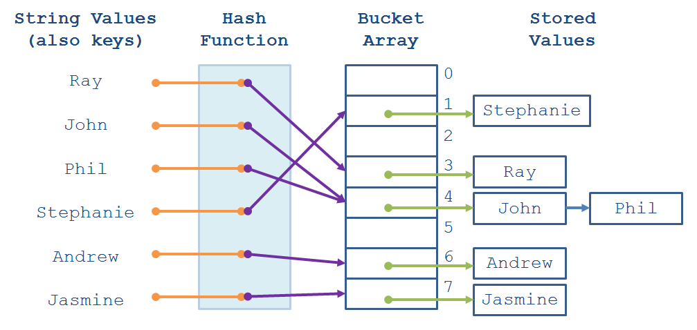 |
| :-: |
| [Fig.1] Diagram of a hash table using separate chaining (Source: [LMU CMSI 281 Class](https://forns.lmu.build/classes/fall-2017/cmsi-281/lecture-14T.html)) |

To insert an element into the table, we use a hash function to calculate the index of the list that will contain it. We call the node storing ```nullptr``` the root node. An empty list consists of this single node, which marks the end of the list. Each new key is inserted before the root node. To prevent duplicates, we must first search the entire list for the element and insert it only if it is absent.

| 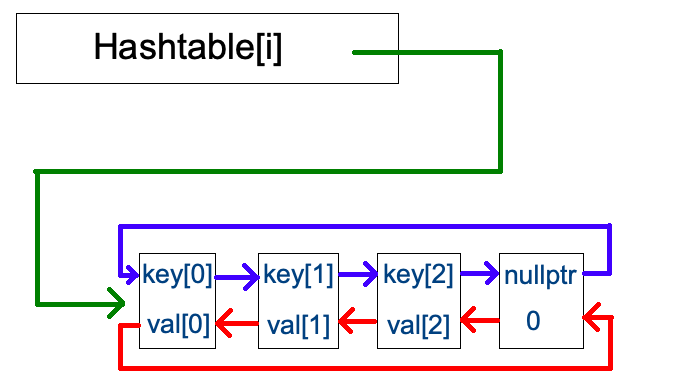 |
| :-:|
| [Fig.2] Diagram of a linked list in the hash table |

The time required to insert an element increases with the length of the list. Our hash function should therefore distribute elements across the lists as evenly as possible to keep their lengths minimal. Let us determine which hash function produces the best distribution.

## Distributions of Different Hash Functions

To obtain more meaningful statistics, we need to fill the hash table well beyond its number of buckets. We will use a load factor of approximately 5: each list should contain at least a few elements so that we can assess the uniformity of the distribution. We will set the table size to ~10000 and insert ~50000 distinct words from ```assets/input/50k_in.txt```. The table size must be a prime number, so ~10000 refers to a prime close to 10000.

In addition to comparing the distributions visually, we will calculate the variance for each function: $$D^2 = \frac{\sum (a_{avg} - a_i)^2}{N}$$

We will compare the following hash functions:
1. [ConstHash](#const) (returns a constant)
2. [FirstLetterHash](#fst_let) (returns the ASCII code of the first letter)
3. [ASCII_SumHash](#sum) (returns the sum of the letters' ASCII codes)
4. [StrLenHash](#strlen) (returns the word length)
5. [ROR_Hash](#ror) (calculates the hash using a bitwise right rotation)
6. [ROL_Hash](#rol) (calculates the hash using a bitwise left rotation)
7. [CRC32_Hash](#crc32) (calculates the hash using the CRC32 algorithm)

<a name="const"></a> 
### ConstHash

This hash function always returns the same number, regardless of its argument.

```cpp
u_int32_t ConstHash(const char* key)
{
    return 1337;
}
```

The plot contains only one bar with a nonzero height. Let us narrow the horizontal range and examine the result.

| 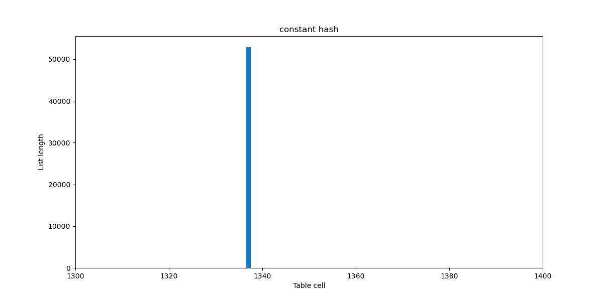 |
| :-: |
| [Fig.3] Distribution of the constant hash |

This is clearly a poor hash function, since it reduces the entire hash table to a single list. In this case, inserting each new element takes $O(n)$ time.

$$D = 528.67$$

<a name="fst_let"></a> 
### FirstLetterHash

This hash function returns the ASCII code of the first letter of the input word.
```cpp
u_int32_t FirstLetterHash(const char* key)
{
    return key[0];
}
```

| 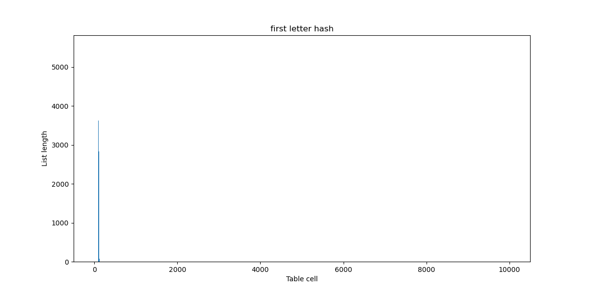 |
| :-: |
| [Fig.4] Distribution of the first-letter hash (zoomed out) |

We can already see that this hash function distributes elements poorly across a large array. Let us zoom in to understand why.

| 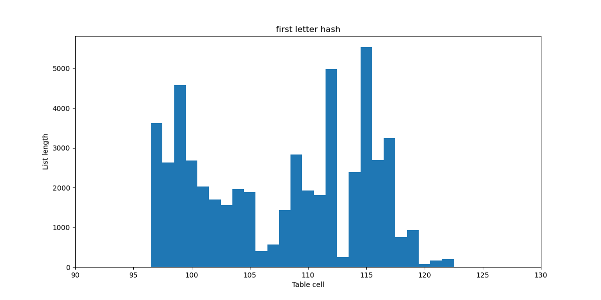 |
| :-: |
| [Fig.5] Distribution of the first-letter hash (zoomed in) |

This distribution occurs because the values fall within a range of 25 distinct ASCII codes for Latin letters. This is better than a constant hash function, but it still performs poorly for large hash tables.

$$D = 127.68$$

<a name="sum"></a> 
### ASCII_SumHash

Now let us consider a function that returns the sum of the ASCII codes of all characters in a word.
```cpp
u_int32_t ASCII_SumHash(const char* key)
{
    size_t len = strlen(key);

    u_int32_t sum = 0;

    for (size_t i = 0; i < len; i++)
        sum += key[i];

    return sum;
}
```

For comparison, let us first test it with a small table. We will reduce the table size to ~500 and the input dataset to ~2500 words.

| 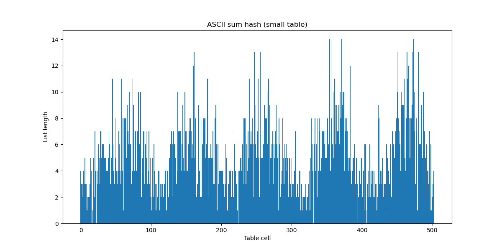 |
| :-: |
| [Fig.6] Distribution of the ASCII-sum hash (small table) |

$$D_{small} = 2.77$$ 

This is a very good result compared with the previous functions. Perhaps this hash function is suitable for further use. Let us check its distribution in a large table to make sure.

| 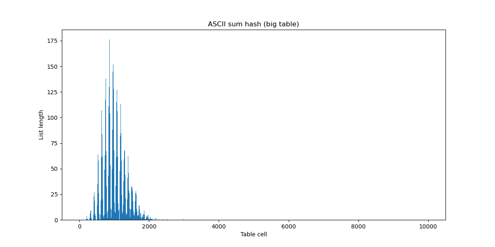 |
| :-: |
| [Fig.7] Distribution of the ASCII-sum hash (large table, zoomed out) |

Something has gone badly wrong. Let us zoom in to find out why.

| 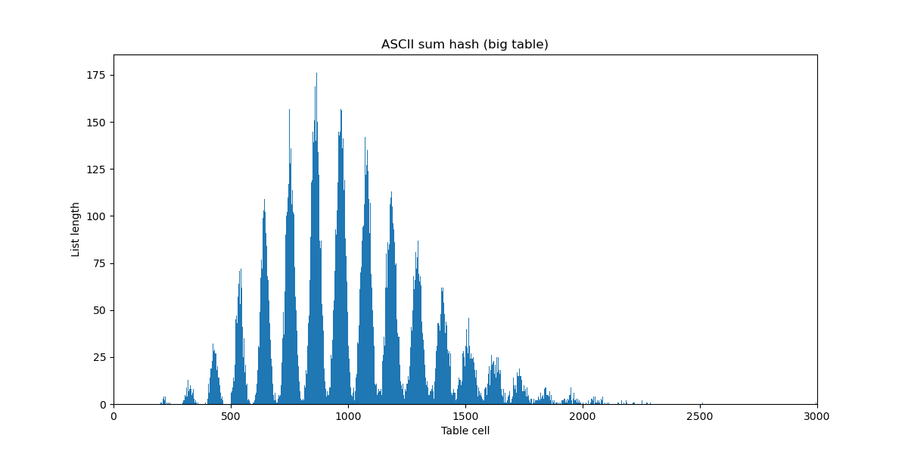 |
| :-: |
| [Fig.8] Distribution of the ASCII-sum hash (large table, zoomed in) |

The hash function performs poorly for several reasons:

1) Lists with indices greater than 2000 are empty. Our dataset simply contains no words long enough to produce these values.
2) The distribution has multiple peaks. This is because the lowest ASCII code among lowercase letters is 97, for 'a'. As a result, words of different lengths have noticeably different sums of ASCII codes.

$$D_{big} = 19.73$$

The variance confirms that the function performs very poorly for large tables.

Why does the behavior differ so much depending on the table size? In small tables, the sum can wrap around modulo the table size, filling the gaps between peaks and spreading values across the entire range. In large tables, this cannot happen, so we get pronounced peaks and list lengths concentrated toward the left side of the plot.

This makes the function rather deceptive. It performs well for small tables of around 500 buckets and may seem suitable for use, but it is unsuitable for larger tables.

<a name="strlen"></a> 
### StrLenHash

This hash function returns the word length.

```cpp
u_int32_t StrLenHash(const char* key)
{
    u_int32_t len = strnlen(key, MAX_KEY_LEN);

    return len;
}
```
| [](assets/pictures/strlen_far.png) |
| :-: |
| [Fig.9] Distribution of the word-length hash (zoomed out) |

All values are concentrated within a very narrow range.

| 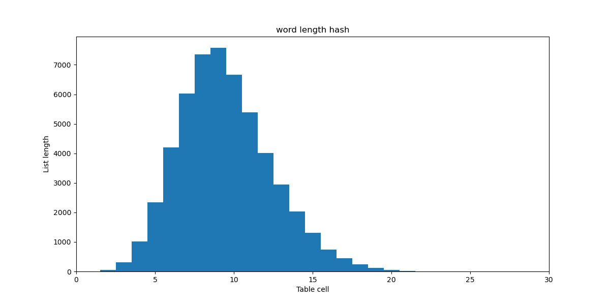 |
| :-: |
| [Fig.10] Distribution of the word-length hash (zoomed in) |

This plot shows which word lengths occur most frequently. Words longer than 15 letters are rare, and some lengths occur more often than others. These characteristics make this function unsuitable for hash tables.

$$D = 166.33$$ 

<a name="ror"></a> 
### ROR_Hash

This function calculates the hash using the ```ror``` instruction. This operation rotates a number, with the final letter (r in this case) indicating rotation to the right. All bits move one position to the right, and the rightmost bit wraps around to the leftmost position. Let us implement this operation in C.

```cpp
uint32_t Ror(uint32_t num)
{
    return ((num >> 1)) | (num << 31);
}
```

We have effectively implemented an assembly instruction as a function. It is interesting to see whether the compiler recognizes it and replaces the function with a single instruction. First, let us compile it without optimization flags:

| 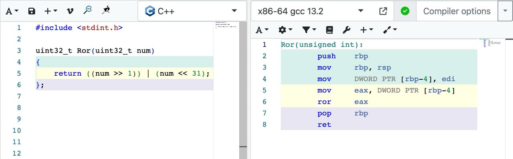 |
| :-: |
| [Fig.11] Compiled right rotation (without optimization flags) |

The compiler recognized the rotation and emitted a ror instruction even without optimization flags. Let us compare this with the optimized version:

| 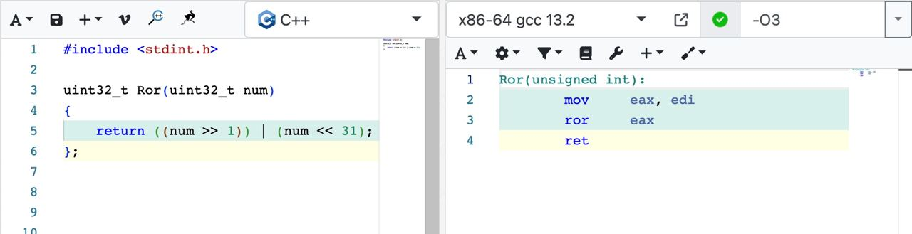 |
| :-: |
| [Fig.12] Compiled right rotation (with optimization flags) |

The compiler simplified the code while retaining the optimization we need.

```cpp
u_int32_t ROR_Hash(const char* key)
{
    u_int32_t hash = 0;

    size_t size = strnlen(key, MAX_KEY_LEN);

    for (size_t i = 0; i < size; i++)
    {
        hash = Ror(hash) ^ key[i];
    }

    return hash;
}
```
| 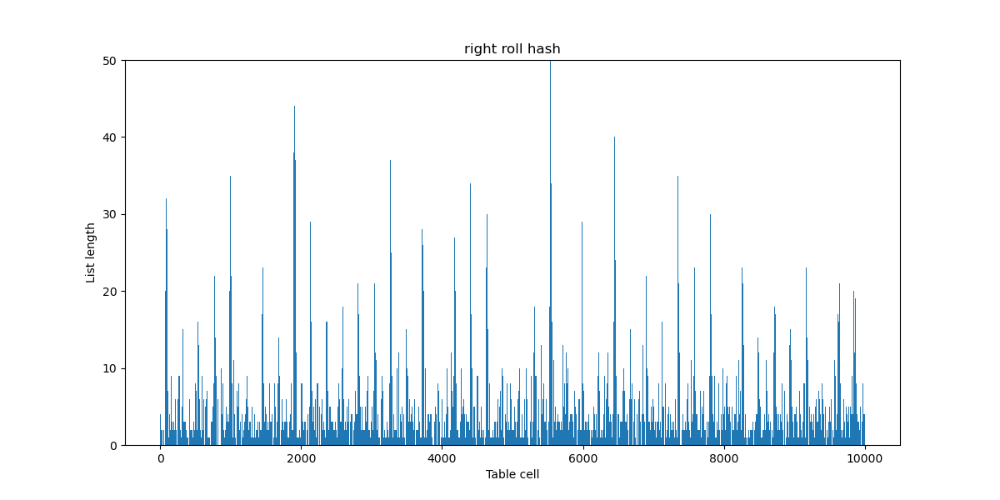 |
| :-: |
| [Fig.13] Distribution of the right-rotation hash |

We can confidently classify this as a good hash function. As the plot shows, it covers all values from 0 to ~10000 fairly evenly, apart from a few isolated peaks.

$$D = 5.72$$

<a name="rol"></a> 
### ROL_Hash

This hash function is almost identical to the previous one, except that it uses the ```rol``` instruction, which rotates a number to the left. We will implement left rotation as follows:

```cpp
uint32_t Rol(uint32_t num)
{
    return ((num << 1)) | (num >> 31);
}
```

Let us repeat the experiment from the previous section. Without optimizations, the compiler produces the following code:

|  |
| :-: |
| [Fig.14] Compiled left rotation (without optimization flags) |

Now with optimization enabled:

|  |
| :-: |
| [Fig.15] Compiled left rotation (with optimization flags) |

As with the previous function, the compiler recognizes the rotation and replaces it with a ```rol``` instruction.

```cpp
u_int32_t ROL_Hash(const char* key)
{
    u_int32_t hash = 0;

    size_t size = strnlen(key, MAX_KEY_LEN);

    for (size_t i = 0; i < size; i++)
    {
        hash = Rol(hash) ^ key[i];
    }

    return hash;
}
```
| 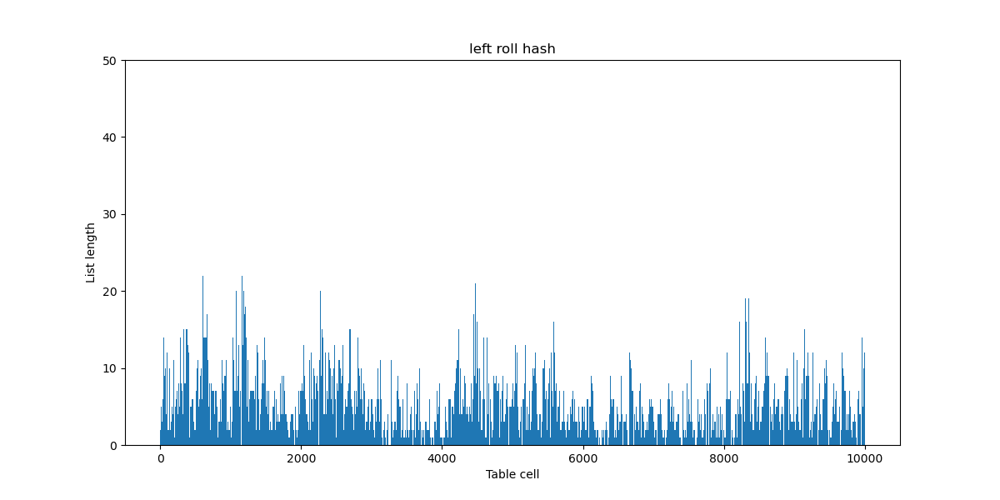 |
| :-: |
| [Fig.16] Distribution of the left-rotation hash |

As with the previous hash function, we obtain a good, uniform distribution across the entire range of indices.

$$D = 3.86$$

<a name="crc32"></a> 
### CRC32_Hash

This hash function uses an algorithm called [CRC](https://en.wikipedia.org/wiki/Cyclic_redundancy_check).

```cpp
u_int32_t CRC32_Hash(const char* key)
{
    uint32_t crc = -1;
    int      i   =  0;

    while (key[i] != 0)
    {
        crc = crc ^ (key[i] << 24);
        for (int bit = 0; bit < 8; bit++)
        {
            if (crc & (1L << 31))
                crc = (crc << 1) ^ 0x04C11DB7;
            else
                crc = (crc << 1);
        }

        i++;
    }
    return ~crc;
}
```
Plotting the distribution gives:

| 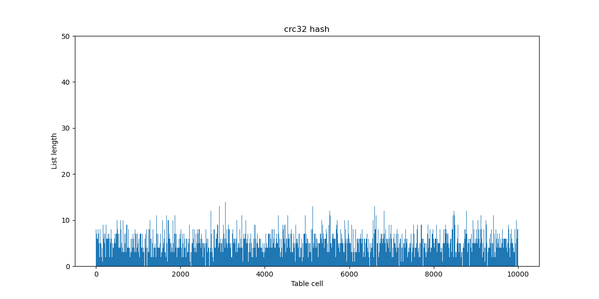 |
| :-: |
| [Fig.17] Distribution of the CRC32 hash |

Visually, this is the most uniform distribution of all the functions considered so far. We will use this function in the rest of the project, since it is the best of those tested.

$$D = 2.30$$

The variance also supports our comparison of the functions.

### Interim Results

Variance for each hash function:


| Hash function               | Variance                                                        |
|:---------------------------:|:---------------------------------------------------------------:|
| [CRC32_Hash](#crc32)        | 2.30                                                            |
| [ASCII_SumHash](#sum) (small) | 2.77                                                           |
| [ROL_Hash](#rol)            | 3.86                                                            |
| [ROR_Hash](#ror)            | 5.72                                                            |
| [ASCII_SumHash](#sum) (large) | 19.74                                                          |
| [FirstLetterHash](#fst_let) | 127.68                                                          |
| [StrLenHash](#strlen)       | 166.33                                                          |
| [ConstHash](#const)         | 528.67                                                          | 

Of all the hash functions considered, ```CRC32_Hash```, ```ROL_Hash```, and ```ROR_Hash``` produce good distributions and can be used for tables of any size. ```ASCII_SumHash``` also deserves a mention: although it performs poorly for large hash tables, it is easy to implement and provides a sufficiently uniform distribution for tables of around 500 buckets. We will consider ```CRC32_Hash``` the best function overall.

## Hash Table Optimizations

Having examined the distributions of several hash functions, we can now focus on the program's execution time. We will fill the hash table with 370000 distinct words from ```370k_in.txt```, also storing these words in an array. We will then iterate through the array 100 times, looking up each word in the hash table. To verify correctness, we will use each word's position in the dictionary as its $val$. The returned value must match the word's index in the array.

We will measure execution time using the ```rdtsc``` assembly instruction. It lets us measure the difference in clock ticks between the beginning and end of the algorithm, which characterizes its execution time. We will run the program 3 times and then calculate the average tick count using the least squares method. Every version will be compiled with the ```-O3 -mavx2``` flags.

We will use this procedure to measure the program's execution time. Let $t_i$ denote the tick count in measurement $i$. $t_{avg}$ is the average tick count across the three measurements, calculated using the least squares method.

|  Program version   |   $t_1$       | $t_2$         | $t_3$         | $t_{avg}$                   |
|:------------------:|:-------------:|:-------------:|:-------------:|:---------------------------:|
| Unoptimized        | $61933960366$ | $60676206064$ | $61926101368$ | $(61.5 \pm 1.0) \cdot 10^9$ |

Typical execution time: ~30 seconds.

### First Optimization (Intrinsics)

Let us try to improve this result with [Valgrind](https://valgrind.org/docs/manual/cl-manual.html). Running ```valgrind  --tool=callgrind ./table```, where ```./table``` is our executable, generates a file containing profiling data for each function. We will view this file using [KCachegrind](https://kcachegrind.sourceforge.net/html/Home.html). This gives us the following information about our functions:

| 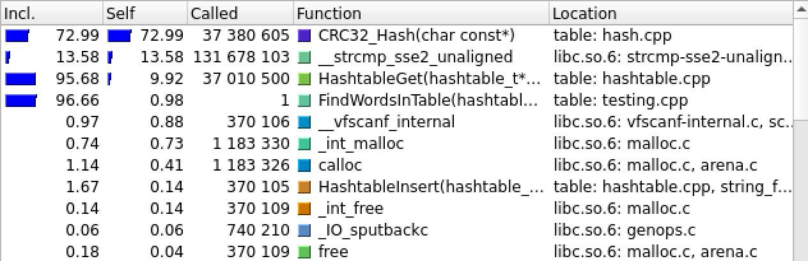|
| :-: |
| [Fig.18] Most expensive functions in the unoptimized hash table |

The most expensive function is the hash calculation, $CRC32_Hash$, so we should optimize it first.

The distribution of the [hash function](#strlen) examined earlier shows that words in our dataset are no longer than 32 characters. From this point on, we will assume that all words in our hash table contain at most 32 characters; longer words will be stored in a second hash table. For an English-language dataset, very few words will go into that second table, so this change should have almost no effect on performance.

The ```_mm_crc32_u32``` intrinsic calculates a hash using the crc32 algorithm. We will optimize the hash calculation using intrinsics, assuming that all words are padded to 32 characters.

```cpp
uint32_t Fast_CRC32_Hash(const char* key)
{
    assert(key);

    uint32_t hash = 0;

    hash = _mm_crc32_u64(hash, *((uint64_t*) key));
    hash = _mm_crc32_u64(hash, *((uint64_t*) key + 1));
    hash = _mm_crc32_u64(hash, *((uint64_t*) key + 2));
    hash = _mm_crc32_u64(hash, *((uint64_t*) key + 3));

    return hash;
}
```

Let us add the results to our measurement table.

|  Program version   |   $t_1$       | $t_2$         | $t_3$         | $t_{avg}$                   |
|:------------------:|:-------------:|:-------------:|:-------------:|:---------------------------:|
| Unoptimized        | $61933960366$ | $60676206064$ | $61926101368$ | $(61.5 \pm 1.0) \cdot 10^9$ |
| Intrinsic crc32    | $36129613314$ | $36106511268$ | $35348591830$ | $(35.8 \pm 0.5) \cdot 10^9$ |

Typical execution time: ~20 seconds.

We can now calculate the speedup from the first optimization. Absolute speedup is measured against the original version, while relative speedup is measured against the previous version of the program.

| Program version  | Absolute speedup     | Relative speedup        |
| :--------------: | :------------------: | :---------------------: |
| Unoptimized      |        $1.0$         |            $1.0$        |
| Intrinsic crc32  |  $1.72 \pm 0.08$     |  $1.72 \pm 0.08$        |

For comparison, let us examine the distribution of the optimized hash function alongside the earlier result.

| 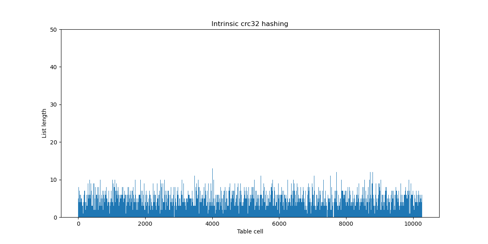|
| :-: |
| [Fig.19] Distribution of the optimized hash function |

$$D = 2.25$$

This implementation may therefore owe part of its speedup to a more uniform distribution.

### Second Optimization (Inline Assembly)

Let us use ```valgrind``` again to identify the function slowing down the program.

| 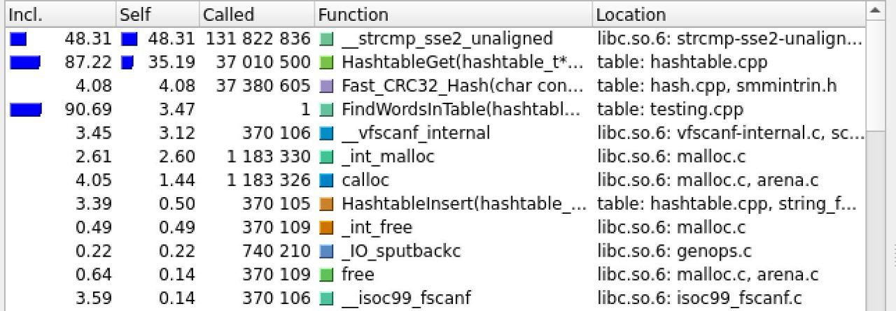|
| :-: |
| [Fig.20] Most expensive functions in the hash table after the first optimization |

The standard library function ```__strcmp_sse2_unaligned``` now takes the most time. Let us find where it is called.

```cpp
node_t* FindKeyInList(node_t* root_cell, const char* key)
{
    ...
    while (cell->key != nullptr)
    {
        if (strcmp(cell->key, key) == 0)
            return cell;

        ...
    }

}
```

This function is called in only one place, to check whether two keys match. We can optimize it by implementing our own function with the following characteristics:

1) We previously agreed to pad words to 32 characters, so each word fits exactly into the ```ymm0``` register. We can load words into these registers and compare their contents using the ```vptest``` instruction.
2) We no longer need to know how the words differ or which comes first lexicographically. To avoid unnecessary calculations, we will return only two possible values: 0 if the strings match and a nonzero value if they differ. A nonzero return value will convey no information about the nature of the difference.

Using these ideas, we will implement our own word comparison function with inline assembly.

```cpp
static inline int _StrCmp(const char* key1, const char* key2)
{
    assert(key1);
    assert(key2);

    int result = 0;

    asm inline
    (
        ".intel_syntax noprefix\n"
        "xor        %0, %0\n"                   // result = 0
        "vmovdqu    ymm0, YMMWORD PTR [%1]\n"   // place str1 in ymm0
        "vptest     ymm0, YMMWORD PTR [%2]\n"   // compare registers
        "setnc      %b0\n"                      // set bit if CF == 0
        "vzeroupper\n"
        ".att_syntax prefix\n"
        : "=&r" (result)
        : "r" (key1), "r" (key2)
        : "ymm0", "cc"
    );

    return result;
}
```

What does the ```vzeroupper``` instruction at the end of the assembly block do? It is [documented](https://www.felixcloutier.com/x86/vzeroupper) as clearing the upper half of the vector registers, which can prevent a penalty when transitioning from AVX instructions to SSE instructions. Let us measure whether it affects the program's performance.

|  Program version        |   $t_1$       | $t_2$         | $t_3$         | $t_{avg}$                   |
|:-----------------------:|:-------------:|:-------------:|:-------------:|:---------------------------:|
| asm strcmp              | $21617596190$ | $23359304322$ | $22169181334$ | $(22.5 \pm 1.0) \cdot 10^9$ |
| asm strcmp + vzeroupper | $22582716722$ | $22035352200$ | $22404409400$ | $(22.3 \pm 0.5) \cdot 10^9$ |

Typical execution time: ~10–15 seconds.

The performance difference between these two versions is small. We will keep ```vzeroupper``` in case it helps later. Now let us calculate the speedup relative to the previous versions.

| Program version  | Absolute speedup     | Relative speedup        |
| :--------------: | :------------------: | :---------------------: |
| Unoptimized      |        $1.0$         |            $1.0$        |
| Intrinsic crc32  |  $1.72 \pm 0.08$     | $1.72 \pm 0.08$         |
| Asm strcmp       |  $2.75 \pm 0.17$     | $1.60 \pm 0.12$         |

### Third Optimization (Assembly Function)

We will repeat the same procedure and analyze the program's performance using ```valgrind```.

| 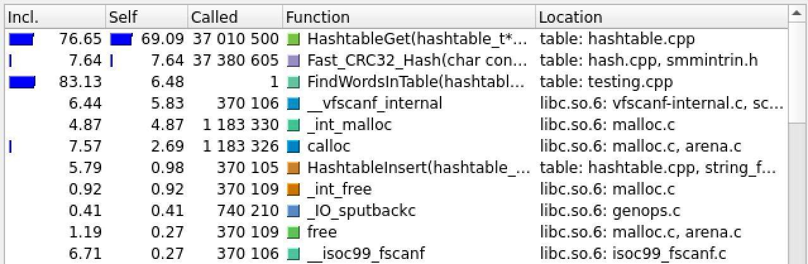|
| :-: |
| [Fig.21] Most expensive functions in the hash table after the second optimization |

The most time is now spent in ```HashtableGet```, which looks up a requested key in the table. Let us examine its code.

```cpp
int HashtableGet(hashtable_t* table, const char* key)
{
    assert(key);
    assert(table);

    size_t index = GetKeyIndex(table, key);        // returns hash-function result
    node_t* root_cell = table->cells[index];

    node_t* key_node = FindKeyInList(root_cell, key);

    if (key_node->key != nullptr)
        return key_node->val;

    return UNKNOWN_VAL;
}
```

The only apparent opportunity for optimization is in ```FindKeyInList```, which it calls to search for an element in a list.

```cpp
node_t* FindKeyInList(node_t* root_cell, const char* key)
{
    node_t* cell = root_cell;

    while (cell->key != nullptr)
    {
        if (_StrCmp(cell->key, key) == 0)
            return cell;

        cell = cell->next;
    }

    return cell;
}
```

Using [Godbolt](https://godbolt.org), we can see how this function is compiled with the ```-O3``` optimization flag.

```nasm
        mov     rdx, QWORD PTR [rdi]               ; rdx = root_cell
        mov     rax, rdi                           ;  |
        test    rdx, rdx                           ;  | return root_cell if cell->key == 0, rax = cur_cell
        jne     .L3                                ;  |
        ret
.L10:
        mov     rax, QWORD PTR [rax+16]            ; cur_cell = cur_cell->next
        mov     rdx, QWORD PTR [rax]               ; rdx = cur_cell->key
        test    rdx, rdx
        je      .L1                                ; return (rax = cur_cell)
.L3:
        .intel_syntax noprefix                     ;  |
        xor        ecx, ecx                        ;  |
        vmovdqu    ymm0, YMMWORD PTR [rdx]         ;  |
        vptest     ymm0, YMMWORD PTR [rsi]         ;  |    Inlined strcmp
        setnc      cl                              ;  |
        vzeroupper                                 ;  |

        test    ecx, ecx                           ; return if strcmp == 0
        jne     .L10
.L1:
        ret
```

There are two possible optimizations:
1) Instead of loading a new word into ```ymm0``` on every iteration, we can load the ```key``` string once at the start and compare this register against the words in the list nodes inside the loop.
2) We do not need to execute ```vzeroupper``` after every iteration, since we do not switch to SSE instructions between iterations. It makes sense to execute ```vzeroupper``` only once, before returning from the function.

Using these observations, we will write our own assembly function for finding a key in a list in a separate file, ```findkey.s```.

```nasm
_FindKey:           mov     rdx, QWORD [rdi]            ; rdx = root_cell
                    vmovdqu ymm0, YWORD [rsi]           ; ymm0 = key
                    mov     rax, rdi                    ;  |
                    test    rdx, rdx                    ;  | return root_cell if cell->key == 0, rax = cur_cell
                    jne     .COMPARE_KEYS               ;  |
                    ret
.LOOP_LIST:
                    mov     rax, QWORD [rax + 16]       ; cur_cell = cur_cell->next
                    mov     rdx, QWORD [rax]            ; rdx = cur_cell->key
                    test    rdx, rdx
                    je      .RETURN                     ; return (rax = cur_cell)
.COMPARE_KEYS:
                    xor        ecx, ecx                 ;  |
                    vptest     ymm0, YWORD [rdx]        ;  |    Inlined strcmp
                    setnc      cl                       ;  |

                    test    ecx, ecx                    ; return if strcmp == 0
                    jne     .LOOP_LIST
.RETURN:
                    vzeroupper
                    ret
```

Now let us measure the execution time of this function.

|  Program version           |   $t_1$       | $t_2$         | $t_3$         | $t_{avg}$                   |
|:--------------------------:|:-------------:|:-------------:|:-------------:|:---------------------------:|
| List key lookup (asm)     | $19632116282$ | $19148328314$ | $18843343012$ | $(19.2 \pm 0.5) \cdot 10^9$ |

Typical execution time: ~10 seconds.

| Program version            | Absolute speedup     | Relative speedup        |
| :------------------------: | :------------------: | :---------------------: |
| Unoptimized                |        $1.0$         |            $1.0$        |
| Intrinsic crc32            |  $1.72 \pm 0.08$     | $1.72 \pm 0.08$         |
| Asm strcmp                 |  $2.75 \pm 0.17$     | $1.60 \pm 0.12$         |
| List key lookup (asm)     |  $3.20 \pm 0.22$     | $1.17 \pm 0.11$         |

The relative speedup is now fairly small, suggesting that we can stop optimizing here. Further changes would make the code considerably more complex while saving relatively little time.

### Optimization Analysis

Optimizations improve program performance but often make the code harder to read. Let us introduce a coefficient that accounts for these factors and use it to compare our optimizations.

$$K = \frac{T_{before}}{T_{after}} \cdot \frac{1}{N_{strings}} \cdot 1000$$

| Program version            | $\frac{T_{before}}{T_{after}}$ | $N_{strings}$           |  $K$          |
| :------------------------: | :----------------------------: | :---------------------: | :-----------: |
| Intrinsic crc32            |   $1.72 \pm 0.08$              | 5                       | $344 \pm 16$  |
| Asm strcmp                 |   $1.60 \pm 0.12$              | 13                      | $123 \pm 9$   |
| List key lookup (asm)     |   $1.17 \pm 0.11$              | 20                      | $58  \pm 5$   |

Overall, the results support my expectations: optimizing the hash function was highly beneficial and kept the code readable, whereas optimizing the key lookup function offered less benefit. Assembly optimizations are not always worthwhile: they may provide only a modest speedup while making the code much harder for another reader to understand.

## Conclusion

This lab demonstrates that the distribution produced by a hash function has a substantial impact on hash table performance. A uniform distribution can make the program tens of times faster. However, it is not the only way to speed up a hash table.

Assembly optimizations, including intrinsics, inline assembly, and functions written in assembly, can improve performance by more than a factor of 3. Readability must also be considered: optimizations often make the code much harder for others to understand and can therefore do more harm than good.


